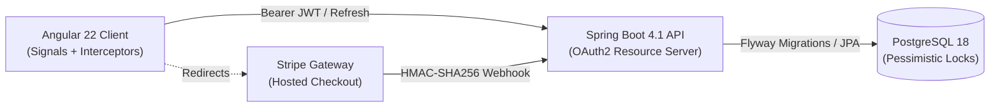

# 🍏 Fruitify Store

[](https://openjdk.org/)
[](https://spring.io/projects/spring-boot)
[](https://angular.dev/)
[](https://www.typescriptlang.org/)
[](https://www.postgresql.org/)
[](https://stripe.com/)
[](https://testcontainers.com/)
[](https://vitest.dev/)

A modern, production-grade full-stack e-commerce grocery platform engineered with **Java 25**, **Spring Boot 4.1**, and **Angular 22**.

Unlike generic CRUD portfolio apps, Fruitify Store addresses production-level distributed challenges: **deadlock-free inventory concurrency**, **asymmetric RSA-2048 signed JWT authentication (RS256)**, **Stripe webhook idempotency**, and a **three-tier test pyramid** with Testcontainers and Vitest.

---

## ⚡ Architectural & Engineering Highlights

* **Deadlock-Free Stock Reservation**: Cart checkout acquires pessimistic write locks (`SELECT ... FOR UPDATE`) with deterministic ID sorting to eliminate database deadlocks during high-concurrency races. Verified with multi-threaded integration stress tests (`OrderConcurrencyTest`).
* **Stateless Asymmetric JWT Authentication**: Built as an **OAuth2 Resource Server** issuing and validating **RS256 (RSA-2048)** signed JWTs, featuring role hierarchy (`ROLE_ADMIN` $\implies$ `ROLE_USER`) and database-backed refresh token rotation.
* **Financial Precision & Idempotency**: Stripe hosted checkout sessions with HMAC-SHA256 signature verification on webhooks. Currency calculations are handled exclusively with `BigDecimal` down to minor units (grosze) with zero float drift.
* **Modern Reactive UI**: Angular 22 standalone architecture powered by **Signals** for fine-grained reactivity, functional HTTP interceptors (automatic token renewal on `401`), and strict TypeScript models mirroring backend DTOs.
* **Database Evolution & Anti-Drift**: 19 Flyway SQL schema migrations validated against Hibernate (`ddl-auto=validate`). Zero auto-generation surprises.

---

## 🏗️ System Architecture



---

## 🛠️ Tech Stack Overview

| Layer | Technologies | Rationale / Key Design |
|---|---|---|
| **Backend** | Java 25, Spring Boot 4.1.1, Spring Security 6 | Records, pattern matching, OAuth2 Resource Server, Nimbus RSA-2048 JWT |
| **Frontend** | Angular 22, TypeScript 6, RxJS 7.8, Vite/Vitest | Standalone components, Signals reactivity, functional guards |
| **Persistence** | PostgreSQL 18, Flyway, Spring Data JPA | Transactional row-level locks, proxy-safe JPA identity |
| **Payments** | Stripe Java SDK 34 | Hosted Checkout Sessions, cryptographic webhook handling |
| **Testing** | Testcontainers 2.0.5, JUnit 5, Vitest, Mockito | Real PostgreSQL container integration, concurrency stress tests |

---

## 🚀 Quick Start

### Prerequisites
* **JDK 25**, **Node.js** (LTS) & **npm**
* **Docker** & Docker Compose
* **OpenSSL** (for RSA key generation)

### 1. Start Database & Backend

Generate an RSA key pair and expose it to the app as base64 environment variables
(first run only):

```bash
mkdir -p ~/.fruitify
openssl genpkey -algorithm RSA -pkeyopt rsa_keygen_bits:2048 -out ~/.fruitify/private.pem
openssl rsa -pubout -in ~/.fruitify/private.pem -out ~/.fruitify/public.pem

export JWT_PRIVATE_KEY="$(base64 -w0 ~/.fruitify/private.pem)"
export JWT_PUBLIC_KEY="$(base64 -w0 ~/.fruitify/public.pem)"
```

Add the same two variables (plus the Stripe keys) to the repo-root `.env` file — it is loaded by
Docker Compose and ignored by git. See `.env.example` for the expected format.

```bash
cd backend
docker compose up -d db

# Run Spring Boot locally (seeds demo products & accounts)
./mvnw spring-boot:run -Dspring-boot.run.profiles=dev
```

Or run the whole backend stack in Docker (DB + API):

```bash
cd backend
docker compose up --build -d
```
* **API**: `http://localhost:8080`
* **Swagger UI**: `http://localhost:8080/swagger-ui.html`

### 2. Start Frontend
```bash
cd frontend
npm install
npm start
```
* **Web App**: `http://localhost:4200`

### Demo Credentials (`dev` profile)
| Role | Email | Password | Permissions |
|---|---|---|---|
| **User** | `user@email.com` | `pass1` | Browse products, manage cart, checkout, view own orders |
| **Admin** | `admin@email.com` | `pass2` | Full access + Product/Category CRUD, global orders management |

---

## 🧪 Testing

```bash
# Backend unit, integration & multi-threaded concurrency tests
# JWT keys come from JWT_PUBLIC_KEY / JWT_PRIVATE_KEY, falling back to
# src/main/resources/certs/{public,private}.pem when the variables are not set.
cd backend && ./mvnw test

# Frontend component & HTTP testing suite (Vitest)
cd frontend && npm test
```
