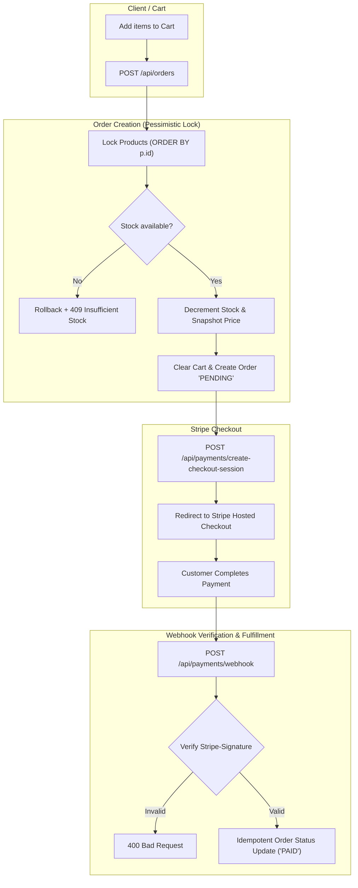

# Fruitify Store Backend

[](https://openjdk.org/)
[](https://spring.io/projects/spring-boot)
[](https://spring.io/projects/spring-security)
[](https://www.postgresql.org/)
[](https://flywaydb.org/)
[](https://stripe.com/)
[](https://testcontainers.com/)

A production-grade REST API backend for an online grocery store, built with **Java 25** and **Spring Boot 4.1.1**.

Unlike typical portfolio CRUD applications, this project is engineered to tackle real-world distributed e-commerce challenges: **deadlock-free concurrency control**, **asymmetric cryptographic authentication (RSA-2048)**, **Stripe payment lifecycle with idempotent webhooks**, and a **three-tier test pyramid** powered by **Testcontainers** and multi-threaded stress tests.

---

## Table of Contents

- [Architectural & Engineering Highlights](#architectural--engineering-highlights)
  - [1. Deadlock-Free Concurrency & Stock Reservation](#1-deadlock-free-concurrency--stock-reservation)
  - [2. Asymmetric RSA-2048 Authentication & Role Hierarchy](#2-asymmetric-rsa-2048-authentication--role-hierarchy)
  - [3. Stripe Hosted Checkout & Cryptographic Webhooks](#3-stripe-hosted-checkout--cryptographic-webhooks)
  - [4. Domain Integrity & Persistence Best Practices](#4-domain-integrity--persistence-best-practices)
- [Order & Payment Flow](#order--payment-flow)
- [Tech Stack](#tech-stack)
- [Project Architecture](#project-architecture)
- [API Overview](#api-overview)
- [Testing Strategy & Concurrency Verification](#testing-strategy--concurrency-verification)
- [Quick Start](#quick-start)
  - [Prerequisites](#prerequisites)
  - [1. Start Database](#1-start-database)
  - [2. Generate RSA Key Pair](#2-generate-rsa-key-pair)
  - [3. Configure Environment](#3-configure-environment)
  - [4. Run Application](#4-run-application)
  - [Demo Accounts](#demo-accounts)
- [Configuration Reference](#configuration-reference)

---

## Architectural & Engineering Highlights

### 1. Deadlock-Free Concurrency & Stock Reservation

A common flaw in e-commerce systems is overselling inventory or causing database deadlocks when multiple shoppers check out overlapping sets of items simultaneously.

```
Shopper A cart: [Item 1, Item 2]  ──┐
                                     ├──> Concurrent Checkout Race Condition
Shopper B cart: [Item 2, Item 1]  ──┘
```

- **Pessimistic Locking (`SELECT ... FOR UPDATE`)**: During order creation, products in the cart are locked in PostgreSQL before validating inventory and deducting stock.
- **Deterministic Lock Ordering**: Locking rows in random order leads to database deadlocks (Transaction A locks Product 1 and waits for Product 2, while Transaction B locks Product 2 and waits for Product 1). This application eliminates deadlocks by strictly ordering IDs prior to lock acquisition:
  ```java
  @Lock(LockModeType.PESSIMISTIC_WRITE)
  @Query("select p from Product p where p.id in :ids order by p.id")
  List<Product> findAllByIdInForUpdate(@Param("ids") Collection<Long> ids);
  ```
- **Automated Stress Testing**: A dedicated multi-threaded integration test (`OrderConcurrencyTest`) uses `ExecutorService` and `CountDownLatch` against a real PostgreSQL 18 Testcontainer to verify that when two users race to purchase the last remaining stock unit, exactly 1 order succeeds, 1 receives an `InsufficientStockException`, and final inventory equals 0 without race conditions.

---

### 2. Asymmetric RSA-2048 Authentication & Role Hierarchy

Instead of a symmetric shared secret (`HS256`), authentication is structured as a stateless **OAuth2 Resource Server** using **asymmetric RSA keys (`RS256`)**:

- **Private Key (`private.pem`)**: Used exclusively by the `TokenService` to sign issued JWTs.
- **Public Key (`public.pem`)**: Used by the resource server security filter to verify incoming token signatures.
- **Role Hierarchy**: Configured via Spring Security's `RoleHierarchyImpl`, enforcing `ROLE_ADMIN` $\implies$ `ROLE_USER`. Administrative accounts automatically inherit regular user permissions without redundant security annotations:
  ```java
  RoleHierarchyImpl.withDefaultRolePrefix()
      .role("ADMIN").implies("USER")
      .build();
  ```
- **Database-Backed Refresh Token Rotation**: Refresh tokens are stored in PostgreSQL with hard expirations and explicit revocation on logout (`POST /api/auth/logout`).
- **N+1 Elimination in User Details**: `UserRepository` utilizes `@EntityGraph(attributePaths = {"roles", "roles.privileges"})` to fetch the complete user authorization graph in a single query during login.

---

### 3. Stripe Hosted Checkout & Cryptographic Webhooks

Payments are integrated using the official **Stripe Java SDK (v34)** via hosted checkout sessions:

- **Zero Floating-Point Inaccuracies**: Currency values are tracked with `BigDecimal(19, 2)` in JPA and safely converted to minor units (grosze) using `movePointRight(2).setScale(0, RoundingMode.UNNECESSARY).longValueExact()`.
- **HMAC-SHA256 Webhook Verification**: The webhook endpoint (`/api/payments/webhook`) validates the raw payload against the cryptographic `Stripe-Signature` header using `Webhook.constructEvent()`, preventing spoofed payment events.
- **Idempotency Guarantee**: Because webhook delivery adheres to at-least-once semantics, `OrderService.changeStatus()` verifies current state under a row-level lock and idempotently returns early if the order is already marked `PAID`.

---

### 4. Domain Integrity & Persistence Best Practices

- **Historical Price Snapshotting**: `OrderItem` captures `priceAtPurchase` independently of `Product.price`. Future price edits never mutate historical accounting receipts.
- **Strict State Machine**: `OrderStatus` enforces allowed transitions (`PENDING -> PAID`, `PENDING -> CANCELLED`, `PAID -> CANCELLED`) with modern Java switch expressions. Cancelling an order automatically locks and restores the reserved product stock.
- **Schema-First Migrations**: Managed via **Flyway** (`V1` through `V19`). Hibernate runs in validation mode (`spring.jpa.hibernate.ddl-auto=validate`) to ensure schema integrity without auto-generation surprises.
- **Proxy-Safe JPA Identity**: Entities implement `equals()` and `hashCode()` using `HibernateProxy.getHibernateLazyInitializer().getPersistentClass()`, avoiding identity bugs across lazy proxies and avoiding Lombok `@Data` anti-patterns on entities.
- **Query Parameter Defense**: Custom `PageableSortValidator` validates incoming sort parameters against strict whitelists before query execution, rejecting invalid fields with `400 Bad Request` to avoid leaking database internals.
- **Modern Java Standards**: Built with immutable Java records for DTOs and configuration classes, and JSpecify (`@NullMarked`, `@Nullable`) for compiler-assisted null safety.

---

## Order & Payment Flow



---

## Tech Stack

| Domain | Technology | Details / Rationale |
|---|---|---|
| **Runtime & Language** | **Java 25** | Records, pattern matching switch, modern JVM features |
| **Framework** | **Spring Boot 4.1.1** | Spring Web MVC, `@MockitoBean`, Testcontainers integration |
| **Security** | **Spring Security 6** | OAuth2 Resource Server, Nimbus RSA-2048 JWT, Role Hierarchy |
| **Database** | **PostgreSQL 18** | Relational persistence with transactional row-level locks |
| **Migrations** | **Flyway** | 19 reproducible SQL migrations, `ddl-auto=validate` |
| **ORM & Data** | **Spring Data JPA / Hibernate** | `@EntityGraph`, Pessimistic locking, Auditing |
| **Payment Gateway** | **Stripe Java SDK 34** | Hosted Checkout Sessions, HMAC-SHA256 signature verification |
| **Testing** | **Testcontainers 2.0.5** | Real PostgreSQL container with `@ServiceConnection` and container reuse |
| **Test Frameworks** | **JUnit 5, Mockito, AssertJ** | WebMvc slices, concurrency latch tests, unit tests |
| **API Documentation** | **Springdoc OpenAPI 3.1.1** | Swagger UI with dual Basic/Bearer auth support |
| **Code Hygiene** | **JSpecify & Lombok** | `@NullMarked` null safety, scoped `@Getter`/`@Setter` (no entity `@Data`) |

---

## Project Architecture

The backend follows a domain-driven **package-by-feature** modular structure:

```text
src/main/java/io/github/guzillo/fruitifystorebackend/
├── auth/            # Sign-up, Basic sign-in, JWT generation, refresh tokens
├── user/            # User profile management and password updates
├── security/        # RSA key config, OAuth2 Resource Server, role hierarchy
├── product/         # Product catalog, active state filtering, admin CRUD
├── category/        # Product categories with cascade-delete protection
├── cart/            # Shopping cart management with stock pre-validation
├── order/           # Order processing, pessimistic lock stock reservation, admin view
├── payment/         # Stripe checkout creation and HMAC webhook validation
├── common/          # GlobalExceptionHandler, PageableSortValidator, AuditableBaseEntity
└── infrastructure/  # JPA and persistence configurations
```

---

## API Overview

Interactive documentation and runnable requests are available in **Swagger UI** at `http://localhost:8080/swagger-ui.html`.

| Endpoint Group | Method & Path | Access Control | Highlights |
|---|---|---|---|
| **Auth** | `POST /api/auth/signup` | Public | Registers user, hashes password, inits empty cart |
| | `POST /api/auth/signin` | HTTP Basic | Returns RSA JWT access token & DB refresh token |
| | `POST /api/auth/refresh` | Public | Issues new JWT using valid refresh token |
| | `POST /api/auth/logout` | Public | Revokes & deletes refresh token from database |
| **User** | `GET /api/users/me` | Authenticated | Fetches current user profile |
| | `PUT /api/users/me/password`| Authenticated | Updates password after verifying current password |
| **Catalog** | `GET /api/products` | Public | Paginated list; inactive items hidden from non-admins |
| | `POST /api/products` | `ADMIN` | Creates product with unique name and category link |
| | `GET /api/categories` | Public | Lists all categories |
| | `DELETE /api/categories/{id}`| `ADMIN` | Deletes category; blocked if products still reference it |
| **Cart** | `GET /api/cart` | Authenticated | Retrieves current user cart and items |
| | `POST /api/cart/items` | Authenticated | Adds product or increments qty after stock check |
| | `PUT /api/cart/items/{id}`| Authenticated | Updates quantity with ownership verification |
| **Orders** | `POST /api/orders` | Authenticated | Converts cart to `PENDING` order with pessimistic stock lock |
| | `GET /api/orders` | Authenticated | Paginated history of user's own orders |
| | `GET /api/admin/orders` | `ADMIN` | Global orders view with customer details |
| | `PATCH /api/admin/orders/{id}/status` | `ADMIN` | Changes order status; restores stock on `CANCELLED` |
| **Payments** | `POST /api/payments/create-checkout-session` | Authenticated | Generates Stripe Hosted Checkout session |
| | `POST /api/payments/webhook` | Public | Validates `Stripe-Signature` and sets status to `PAID` |

---

## Testing Strategy & Concurrency Verification

The test suite consists of **23 test classes** organized across the test pyramid:

```
          ▲
         / \     Multi-threaded Concurrency Test (OrderConcurrencyTest)
        /   \    Spring Boot + Testcontainers PostgreSQL (@SpringBootTest)
       /─────\   Web Layer Slices (@WebMvcTest + @MockitoBean)
      /───────\  Unit Tests (Mockito + AssertJ, zero context overhead)
```

1. **Multi-Threaded Concurrency Testing (`OrderConcurrencyTest`)**:
   Runs multi-threaded checkout scenarios using `ExecutorService` and `CountDownLatch` across real database transactions to guarantee that pessimistic row locking eliminates race conditions and overselling.
2. **Integration Tests with Testcontainers (`@SpringBootTest`)**:
   Spins up a real PostgreSQL 18 container using Spring Boot's `@ServiceConnection` and executes the full Flyway migration chain (`V1`–`V19`).
3. **Web Layer Slice Tests (`@WebMvcTest`)**:
   Tests controllers in isolation with `@MockitoBean`. Validates HTTP status codes, Bean Validation (`@Valid`), JSON payloads, and role-based security (`hasRole('ADMIN')` vs `hasRole('USER')`).
4. **Fast Unit Tests**:
   Pure Mockito tests with zero Spring context overhead for domain services and state machine transitions (`OrderStatusTest`).

To run the complete test suite:

```bash
./mvnw test
```

> [!TIP]
> **Faster Local Runs**: Testcontainers supports container reuse. Set `TESTCONTAINERS_REUSE_ENABLE=true ./mvnw test` to reuse the existing PostgreSQL container between test invocations.

---

## Quick Start

### Prerequisites

- **JDK 25**
- **Docker** and Docker Compose
- **OpenSSL** (for RSA key pair generation)
- **Stripe Account** (test API keys)

### 1. Start Database

Start PostgreSQL 18 in the background:

```bash
docker compose up -d db
```

### 2. Generate RSA Key Pair

JWT signing keys are excluded from version control. Generate a 2048-bit RSA key pair in `src/main/resources/certs`:

```bash
mkdir -p src/main/resources/certs
openssl genpkey -algorithm RSA -pkeyopt rsa_keygen_bits:2048 -out src/main/resources/certs/private.pem
openssl rsa -pubout -in src/main/resources/certs/private.pem -out src/main/resources/certs/public.pem
```

### 3. Configure Environment

Set your Stripe test API credentials:

```bash
export STRIPE_SECRET_KEY=sk_test_...
export STRIPE_WEBHOOK_SECRET=whsec_...
```

*(Optional)* If testing webhooks locally, forward Stripe events to localhost:
```bash
stripe listen --forward-to localhost:8080/api/payments/webhook
```

### 4. Run Application

Run with the `dev` profile to seed sample products and test users:

```bash
./mvnw spring-boot:run -Dspring-boot.run.profiles=dev
```

- **Swagger UI**: [http://localhost:8080/swagger-ui.html](http://localhost:8080/swagger-ui.html)
- **OpenAPI JSON**: [http://localhost:8080/v3/api-docs](http://localhost:8080/v3/api-docs)
- **Health Check**: [http://localhost:8080/actuator/health](http://localhost:8080/actuator/health)

### Demo Accounts

Available when running with `-Dspring-boot.run.profiles=dev`:

| Role | Email | Password | Permissions |
|---|---|---|---|
| **User** | `user@email.com` | `pass1` | Browse products, manage cart, checkout, view own orders |
| **Admin** | `admin@email.com` | `pass2` | Full access + Product/Category CRUD, global orders management |

---

## Configuration Reference

Key properties configured in `src/main/resources/application.properties`:

| Property | Default / Example | Purpose |
|---|---|---|
| `spring.datasource.url` | `jdbc:postgresql://localhost:5432/postgres` | PostgreSQL connection string |
| `spring.jpa.hibernate.ddl-auto` | `validate` | Validates schema without modifying production tables |
| `rsa.private-key` | `classpath:certs/private.pem` | RSA 2048-bit private key for JWT signing |
| `rsa.public-key` | `classpath:certs/public.pem` | RSA 2048-bit public key for JWT verification |
| `stripe.secret-key` | `${STRIPE_SECRET_KEY}` | Stripe secret API key (validated via regex record) |
| `stripe.webhook-secret` | `${STRIPE_WEBHOOK_SECRET}` | Secret used to verify Stripe webhook signatures |
| `stripe.domain` | `http://localhost:3000` | Return redirect URL for completed checkouts |
