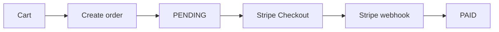

# Fruitify Store Backend

REST API for an online fruit and vegetable store. The project covers user
registration and authentication, a product catalog, shopping carts, orders,
administrative order management and Stripe Checkout payments.

> Portfolio project focused on authentication, role-based access control,
> transactional order processing and external payment integration.

## Highlights

- JWT authentication with access and refresh tokens
- `USER` and `ADMIN` role-based authorization
- Product and category management with stock control
- Shopping carts and order lifecycle management
- Stripe Checkout integration with webhook verification
- PostgreSQL persistence with Flyway migrations
- OpenAPI documentation and Swagger UI
- Unit, MVC and integration tests with Testcontainers

## Tech stack

| Area | Technology |
|---|---|
| Language / runtime | Java 25 |
| Framework | Spring Boot 4.1.1, Spring Web MVC |
| Security | Spring Security, OAuth2 Resource Server, RSA-signed JWT |
| Persistence | Spring Data JPA, Hibernate |
| Database | PostgreSQL 18 |
| Migrations | Flyway |
| Payments | Stripe Java SDK |
| API documentation | springdoc-openapi 3.1.1, Swagger UI |
| Testing | JUnit 5, Mockito, AssertJ, Testcontainers 2.0.5 |
| Build | Maven |

## Quick start

Run the commands in this section from the `backend/` directory:

### Prerequisites

- JDK 25
- Docker with Docker Compose
- `openssl`
- Stripe test account and API keys

### 1. Start PostgreSQL

```bash
docker compose up -d db
```

The Compose service exposes PostgreSQL on `localhost:5432` and uses the
`postgres` database user with the password configured in `compose.yml`.

### 2. Generate RSA keys

JWT keys are intentionally ignored by Git. Generate them once before starting
the application:

```bash
mkdir -p src/main/resources/certs
openssl genpkey -algorithm RSA -pkeyopt rsa_keygen_bits:2048 \
  -out src/main/resources/certs/private.pem
openssl rsa -pubout -in src/main/resources/certs/private.pem \
  -out src/main/resources/certs/public.pem
```

### 3. Configure Stripe

```bash
export STRIPE_SECRET_KEY=sk_test_...
export STRIPE_WEBHOOK_SECRET=whsec_...
```

For local webhook testing, expose the application to Stripe using the Stripe
CLI or another HTTPS tunnel and configure the resulting signing secret as
`STRIPE_WEBHOOK_SECRET`.

### 4. Run the application

The `dev` profile creates demo users and sample products:

```bash
./mvnw spring-boot:run -Dspring-boot.run.profiles=dev
```

Application URLs:

| Resource | URL |
|---|---|
| Application | `http://localhost:8080` |
| Swagger UI | `http://localhost:8080/swagger-ui.html` |
| OpenAPI JSON | `http://localhost:8080/v3/api-docs` |
| OpenAPI YAML | `http://localhost:8080/v3/api-docs.yaml` |
| Actuator health | `http://localhost:8080/actuator/health` |

Demo accounts are available only with the `dev` profile:

| Role | Email | Password |
|---|---|---|
| User | `user@email.com` | `pass1` |
| Admin | `admin@email.com` | `pass2` |

Stop the local database with:

```bash
docker compose down
```

Use `docker compose down -v` when the local PostgreSQL volume should also be
removed.

## Configuration

The main configuration is in
`src/main/resources/application.properties`.

| Property | Meaning |
|---|---|
| `spring.datasource.url` | PostgreSQL connection URL |
| `spring.datasource.username/password` | Database credentials |
| `spring.jpa.hibernate.ddl-auto=validate` | Validate the schema; Hibernate does not create it |
| `rsa.private-key` / `rsa.public-key` | PEM keys used to sign and verify JWTs |
| `stripe.secret-key` | Stripe API key |
| `stripe.webhook-secret` | Secret used to verify the `Stripe-Signature` header |
| `stripe.domain` | Frontend base URL used in Stripe return URLs |

Flyway manages the database schema. Migrations are stored in
`src/main/resources/db/migration` and use the
`V<n>__DESCRIPTION.sql` naming convention. Never edit an already-applied
migration; add a new migration instead.

## Authentication

1. Register with `POST /api/auth/signup`.
2. Sign in with `POST /api/auth/signin` using HTTP Basic authentication
   (`email:password`).
3. Use the returned access token on protected endpoints:

   ```http
   Authorization: Bearer <access-token>
   ```

4. Refresh the access token with `POST /api/auth/refresh`.
5. Revoke the refresh token with `POST /api/auth/logout`.

In Swagger UI, click **Authorize** and use `basicAuth` for sign-in or
`bearerAuth` for protected endpoints. `ADMIN` users inherit `USER`
permissions.

## API overview

The complete request and response schemas are available in Swagger UI. The
main endpoint groups are:

| Area | Endpoints | Access |
|---|---|---|
| Authentication | `/api/auth/signup`, `/signin`, `/refresh`, `/logout` | Public / Basic |
| User profile | `/api/users/me`, `/api/users/me/password` | Authenticated user |
| Products | `/api/products` | Public reads, `ADMIN` writes |
| Categories | `/api/categories` | Public reads, `ADMIN` writes |
| Cart | `/api/cart` and `/api/cart/items` | Authenticated user |
| Orders | `/api/orders` | Authenticated user |
| Admin orders | `/api/admin/orders` | `ADMIN` |
| Payments | `/api/payments/create-checkout-session` | Authenticated user |
| Stripe webhook | `/api/payments/webhook` | Stripe signature |

Development-only diagnostic endpoints are available under `/api/health` when
the `dev` profile is active.

Inactive products are visible only to administrators. Deleting a category
that is used by a product is rejected.

## Pagination and sorting

Paginated endpoints accept `page`, `size` and `sort` parameters:

```http
GET /api/products?page=0&size=20&sort=price,asc
```

The default page size is `20` and the maximum is `100`. Unsupported sort
properties return `400 Bad Request`.

Supported sort properties:

- products: `id`, `name`, `price`, `stockQuantity`
- user orders: `createdAt`, `totalAmount`
- admin orders: `createdAt`, `totalAmount`, `status`

## Order and payment flow



1. Add products to the cart.
2. Create an order from the cart. The order starts as `PENDING`, stock is
   decreased and the cart is cleared.
3. Create a Stripe Checkout session using the order's `orderNumber`.
4. Stripe sends a verified `checkout.session.completed` webhook.
5. The order changes to `PAID`.

Allowed status transitions are `PENDING -> PAID`,
`PENDING -> CANCELLED` and `PAID -> CANCELLED`. Cancelling an order restores
the reserved product stock.

## Errors

The API returns an appropriate HTTP status and a readable error response.
Common status codes include:

| Status | Meaning |
|---|---|
| `400` | Validation error or invalid sorting |
| `401` | Missing or invalid credentials |
| `403` | Missing required role |
| `404` | Resource not found |
| `409` | Business conflict, such as insufficient stock |
| `503` | Stripe unavailable |

## Tests

Run the full test suite with:

```bash
./mvnw test
```

Tests require Docker because Testcontainers starts a shared `postgres:18`
container and runs the Flyway migrations against it. The RSA keys from the
Quick Start section are also required.

Test structure:

- `@WebMvcTest` — controller and security behavior without a database
- `@SpringBootTest` with Testcontainers — repository and service integration
- unit tests — service logic with Mockito and no Spring context

For faster local runs, Testcontainers can reuse its container:

```bash
TESTCONTAINERS_REUSE_ENABLE=true ./mvnw test
```

## Project structure

The application uses a feature-based package structure:

```text
src/main/java/io/github/guzillo/fruitifystorebackend/
├── auth/            registration, sign-in and refresh tokens
├── user/            user profiles
├── security/        JWT, roles and Spring Security configuration
├── product/         product catalog
├── category/        product categories
├── cart/            shopping carts
├── order/           orders and administration
├── payment/         Stripe Checkout and webhooks
├── common/          exceptions, pagination and OpenAPI configuration
└── infrastructure/  persistence configuration
```

The typical request flow is:

```text
Controller -> Service -> Repository -> PostgreSQL
```

For production deployments, disable or protect Swagger UI and OpenAPI
endpoints, and provide secrets through the deployment environment rather than
committing them to configuration files.
