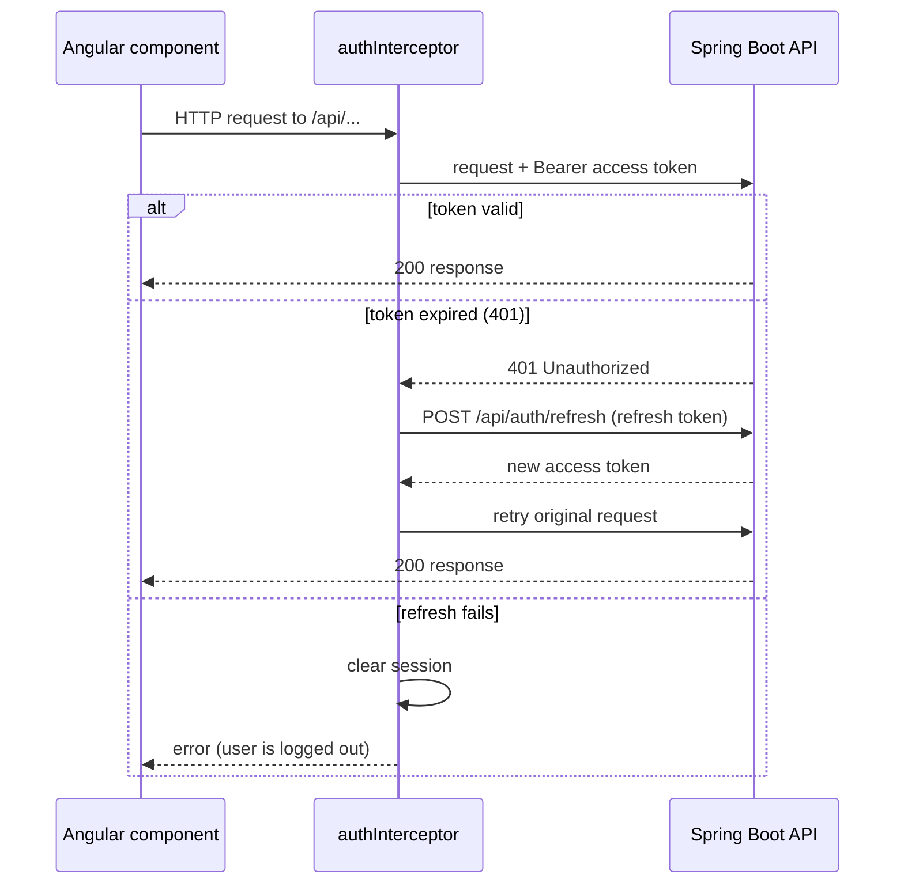

# Fruitify Store Frontend

[](https://angular.dev/)
[](https://www.typescriptlang.org/)
[](https://rxjs.dev/)
[](https://vitest.dev/)

The customer and admin web application for the Fruitify Store, built with **Angular 22** on top of the Spring Boot REST API in [`../backend`](../backend/README.md).

The app uses **standalone components**, **signals** for component state, **reactive forms**, **functional route guards**, and a **functional HTTP interceptor** that attaches the JWT to API calls and refreshes it when it expires.

---

## Table of Contents

- [Features](#features)
- [Tech Stack](#tech-stack)
- [Quick Start](#quick-start)
  - [Prerequisites](#prerequisites)
  - [1. Start the Backend](#1-start-the-backend)
  - [2. Install Dependencies](#2-install-dependencies)
  - [3. Run the Dev Server](#3-run-the-dev-server)
- [Scripts](#scripts)
- [Pages and Routes](#pages-and-routes)
- [Authentication and Sessions](#authentication-and-sessions)
- [Roles and Admin Controls](#roles-and-admin-controls)
- [Project Architecture](#project-architecture)
- [Configuration](#configuration)
- [Testing](#testing)
- [Production Build](#production-build)

---

## Features

**Shopping**
- Product catalogue with paging and category filter
- Product detail page with stock status
- Cart with quantity changes, removal and total in PLN
- Checkout with shipping details, redirecting to Stripe Hosted Checkout
- Order history and order detail, with **Pay now** and **Cancel order** for unpaid orders

**Account**
- Registration, login and logout
- Profile page: edit name and email, change password
- Session restored on page reload

**Admin** (shown only to users with the `ROLE_ADMIN` role)
- Create, edit, hide/show and delete products from the existing product pages
- Browse all customers' orders, mark orders as paid, and cancel them

---

## Tech Stack

| Domain | Technology | Details / Rationale |
|---|---|---|
| **Framework** | **Angular 22** | Standalone components, `@if` / `@for` control flow, signal inputs and outputs |
| **Language** | **TypeScript 6** | Strict typing for API models that mirror the backend DTOs |
| **Reactivity** | **Signals + RxJS 7.8** | Signals for view state, RxJS for HTTP streams and route params |
| **Forms** | **Reactive Forms** | Typed `FormGroup` / `FormControl` with the same validation rules as the backend |
| **HTTP** | **`HttpClient` + functional interceptor** | Adds `Authorization: Bearer` and retries once after a refresh |
| **Build** | **Angular CLI 22 (`@angular/build`)** | esbuild-based builds and dev server |
| **Tests** | **Vitest 5 via `ng test`** | Component tests with `HttpTestingController` and `TestBed` |
| **Formatting** | **Prettier 3** | Configured in `.prettierrc` |

---

## Quick Start

### Prerequisites

- **Node.js** (current LTS) and **npm**
- The **backend** running on `http://localhost:8080`, see [`../backend/README.md`](../backend/README.md)

### 1. Start the Backend

```bash
cd ../backend
docker compose up -d db
./mvnw spring-boot:run -Dspring-boot.run.profiles=dev
```

The `dev` profile seeds sample products and the demo accounts listed in the backend README.

### 2. Install Dependencies

```bash
cd frontend
npm install
```

### 3. Run the Dev Server

```bash
npm start
```

Open [http://localhost:4200](http://localhost:4200). The app reloads automatically when you change a file.

> [!NOTE]
> The backend allows browser requests from `http://localhost:4200` only (`app.cors.allowed-origins`). Use that exact address, not `127.0.0.1`.

---

## Scripts

| Command | What it does |
|---|---|
| `npm start` | Starts the dev server on port 4200 |
| `npm run build` | Production build into `dist/frontend/` |
| `npm run watch` | Development build that rebuilds on every change |
| `npm test` | Runs the unit tests once with Vitest through `ng test` |

---

## Pages and Routes

| Route | Page | Access | Notes |
|---|---|---|---|
| `/` | Home | Public | Product grid, category filter, paging; admin: **+ New product** |
| `/products/:id` | Product detail | Public | Add to cart; admin: edit, hide/show, delete |
| `/cart` | Cart | Logged in | Quantity changes, removal, total |
| `/checkout` | Checkout | Logged in | Shipping form; after Stripe returns, shows a thank-you message |
| `/orders` | My orders | Logged in | Paged history; admin: **All customers** view with status actions |
| `/orders/:id` | Order detail | Logged in | Pay now and cancel while unpaid; notice when payment was cancelled |
| `/profile` | Profile | Logged in | Edit details and change password |
| `/login` | Log in | Public | Returns to the page that asked for login (`returnUrl`) |
| `/register` | Register | Public | Creates the account and signs in straight away |

Pages marked **Logged in** use `authGuard`. A visitor without a stored token is sent to `/login`, and the page they wanted is kept in `returnUrl`.

---

## Authentication and Sessions

The backend issues two tokens:

- **Access token**: a short-lived RSA-signed JWT (1 hour), sent as `Authorization: Bearer <token>`
- **Refresh token**: an opaque token, used to get a new access token

Login uses HTTP Basic once (`POST /api/auth/signin`). After that, the tokens are stored in `localStorage` and the request flow is:



Calls to `/api/auth/**` are never given a Bearer token, so sign-in and refresh cannot loop.

---

## Roles and Admin Controls

The access token carries the user's roles in its `scope` claim. `AuthService` reads that claim and exposes an `isAdmin` signal, which decides which controls are shown.

> [!IMPORTANT]
> The browser does **not** verify the token signature. The admin controls are only a convenience. Every admin action is checked by the backend (`hasRole('ADMIN')`), so a user who edits the UI still gets `403 Forbidden` from the API.

After a role change, the user has to log in again (or wait for a token refresh) before the controls appear.

---

## Project Architecture

Feature folders, with shared services and models at the top level:

```text
src/app/
├── app.ts / app.html        # Shell: header with auth links and cart/orders/profile links
├── app.routes.ts            # Route table with guards
├── app.config.ts            # Providers: router, HttpClient, auth interceptor
├── auth/                    # Login, register, profile pages and authGuard
├── cart/                    # Cart page and the shared AddToCart button
├── checkout/                # Shipping form and Stripe redirect
├── home/                    # Product grid, category filter, admin "New product"
├── interceptors/            # authInterceptor (Bearer header, refresh on 401)
├── models/                  # TypeScript interfaces mirroring backend DTOs
├── orders/                  # Order list (own or all) and order detail
├── product/                 # Product detail and the admin ProductForm
└── services/                # HttpClient wrappers: auth, product, category, cart, order, payment
```

Conventions used across the code:

- **Services** own HTTP calls and return `Observable`s. Components subscribe and update signals.
- **Models** match the backend DTO field names exactly, e.g. `ProductResponseDTO` → `Product`.
- **Route params** are read through `paramMap` with `switchMap`, so the page reloads when the URL changes.
- **Errors** are mapped to user messages by HTTP status (`409` for stock or state conflicts, `404` for missing items, `401` for login failures).

---

## Configuration

The API address is set in each service file as `http://localhost:8080/api/...`. To point the app at another backend, change those constants.

| Setting | Current value | Where |
|---|---|---|
| API base URL | `http://localhost:8080/api` | `src/app/services/*.service.ts`, `src/app/interceptors/auth.interceptor.ts` |
| Allowed origin on the backend | `http://localhost:4200` | `backend/src/main/resources/application.properties` (`app.cors.allowed-origins`) |
| Stripe return URL | `http://localhost:4200` | `backend/src/main/resources/application.properties` (`stripe.domain`) |

> [!TIP]
> The API address is repeated in several files. Moving it into an Angular `environments/` file or an `InjectionToken` would make deployments easier. This is planned but not done yet.

---

## Testing

```bash
npm test
```

The suite uses Vitest through `ng test` and covers:

- **Components**: rendering, form submission and state changes (`home`, `product-detail`, `product-form`, `cart-page`, `add-to-cart`, `profile`, `checkout`, `order-detail`)
- **HTTP calls**: `HttpTestingController` checks each request's method, URL and body, then flushes a response
- **Routing and forms**: the shell's header links for logged-in and logged-out users, and checkout's success view

To check everything before a commit:

```bash
npm test && npm run build
```

---

## Production Build

```bash
npm run build
```

The output goes to `dist/frontend/`. Before deploying:

1. Replace the `localhost` API addresses (see [Configuration](#configuration)).
2. Allow the production origin in the backend's `app.cors.allowed-origins`.
3. Set `stripe.domain` to the production frontend URL, so Stripe returns users to the right place.
4. Serve the app over HTTPS. The access token is kept in `localStorage`, so the app should only be served from a trusted origin.
